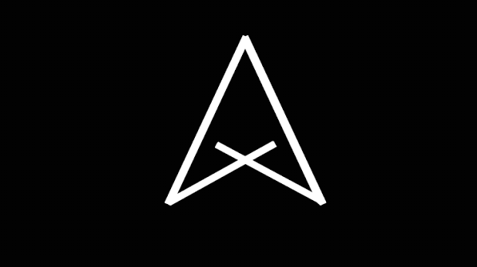

<div align="center">

  <!-- Logo Banner -->
  

  # ⚡ Aditya Narayan Dash
  ### MCA Scholar @ KIIT University | Full-Stack & Software Developer

  <p align="center">
    📍 <b>Puri & Bhubaneswar, Odisha, India</b> 🇮🇳
  </p>

  <!-- Dynamic Badges -->
  <p align="center">
    <a href="mailto:adityanarayandash100@gmail.com">
      
    </a>
    <a href="https://www.linkedin.com/in/aditya-narayan-dash-67b14b38a" target="_blank">
      
    </a>
    <a href="https://www.instagram.com/aditya___2004___" target="_blank">
      
    </a>
  </p>

  <!-- Interactive Call-To-Action Button -->
  <p align="center">
    <a href="https://your-username.github.io/your-repo-name/">
      
    </a>
  </p>

</div>

---

## 👨‍💻 About Me

<div align="left">


- 🎓 **Master of Computer Applications (MCA)** at **KIIT Deemed to be University**, Bhubaneswar (Batch 2026–2028).
- 🎓 **Bachelor of Computer Applications (BCA)** from **CMT, Puri** (Utkal University) with **8.59 CGPA (79.47%)**.
- 🏫 Alumnus of **St. Xavier's High School** (Montessori 1 to Standard 12).
- 💡 Passionate about core computer science, software architecture, and building user-first web applications.
- 💬 Ask me about **HTML, CSS, JavaScript, C/C++, Java, DBMS, and Web Architecture**.

</div>

<br clear="both" />

---

## 🛠️ Tech Stack & Skills

<p align="center">
  
  
  
  
  
  
  
  
  
</p>

---

## 🎓 Academic Timeline

<details open>
<summary><b>Click to expand/collapse Academic Roadmap</b></summary>
<br>

| Level / Degree | Institution / Board | Score / Status | Tenure |
| :--- | :--- | :---: | :---: |
| **MCA** | KIIT Deemed to be University, Bhubaneswar | *Pursuing* | **2026 – 2028** |
| **BCA** | College of Management & Technology (CMT), Puri (Utkal Univ.) | **8.59 CGPA (79.47%)** | Completed 2026 |
| **Class 12th (+2 Science)** | St. Xavier's High School (PCMBE) | **66%** | Completed |
| **Class 10th (Secondary)** | St. Xavier's High School | **85%** | Completed |
| **Foundational Schooling** | St. Xavier's High School | *Passed* | Montessori 1 – Class 9 |

</details>

---

## 📂 Project Structure

```text
├── 📄 index.html        # Main single-page interactive portfolio & CV
├── 🖼️ profile.jpg       # Profile portrait photo
├── 🖼️ logo.jpg          # Custom geometric brand logo
└── 📖 README.md         # Repository documentation
